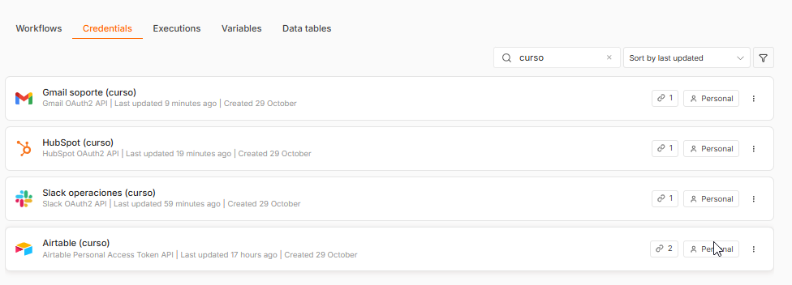

# Checkpoint 4 · Sincronización del cerebro agéntico con ecosistemas de negocio

**Alumno:** Ignacio Iantorno · **Proyecto integrador:** agente de IANTOIA (M1 → M11)
**Archivo:** [`checkpoint4_ignacio_iantorno.json`](checkpoint4_ignacio_iantorno.json) · **Workflow:** `[Curso] M4: Soporte por Gmail con HubSpot y Slack`

Evolución del Manager del Módulo 3, que tenía memoria híbrida: Simple Memory más un resumen persistente en Airtable por `Session_ID`. A ese agente se le suman tres herramientas externas reales, conectadas por OAuth2:

| Rol en el caso del vivo | Herramienta | Credencial en n8n |
|---|---|---|
| CRM / fuente única de verdad del cliente | **HubSpot** | `HubSpot (curso)` · HubSpot OAuth2 API |
| Casilla de soporte al cliente | **Gmail** | `Gmail soporte (curso)` · Gmail OAuth2 API |
| Canal del equipo de operaciones | **Slack** (#operaciones) | `Slack operaciones (curso)` · Slack OAuth2 API |

## Credenciales activas (OAuth2)



*Airtable es la memoria de largo plazo que viene del Módulo 3.*

## Flujo

```
[Gmail Trigger: correo entrante a +soporte]
        │
        ▼
① [IF ¿Es respuesta automática?] ── Sí ─▶ [Ignorar correo automático (corta el bucle)]
        │ No
        ▼
④ [Set Limpiar payload del correo] → [Filter ¿Tiene email válido?]
        │
        ▼
   [Memoria del M3: Airtable por Session_ID = email del remitente]
        │
        ▼
   [AI Agent: clasifica y redacta]  → (en paralelo) resumen y escritura de memoria en Airtable
        │
        ▼
   [Set Armar registro limpio del caso]
        │
        ▼
② [HubSpot Buscar contacto por email] → [IF ¿El contacto ya existe?]
        ┌───────────┴───────────┐
        Sí                      No
        ▼                       ▼
[Actualizar contacto]     [Crear contacto nuevo]
        └───────────┬───────────┘
                    ▼
③ [Gmail Draft › Create: Guardar borrador de respuesta]   (human-in-the-loop)
                    │
                    ▼
④ [Set Resumen liviano para Slack] → [Slack Avisar en #operaciones]
```

## Los cuatro controles

| # | Nodo | Qué previene | Cómo |
|---|---|---|---|
| ① | **¿Es respuesta automática?** (IF, inmediatamente después del trigger) | Bucle infinito de auto-respuestas | Condición OR, sin distinguir mayúsculas. El asunto contiene *Auto-reply, Automatic reply, Respuesta automática, Out of office, Fuera de la oficina, Undeliverable* o *Delivery Status Notification*; el remitente contiene *no-reply, noreply, mailer-daemon* o *postmaster*; o el correo trae el encabezado `Auto-Submitted: auto-*`. Esos correos terminan en un nodo No Op. |
| ② | **Buscar contacto en HubSpot** + **¿El contacto ya existe?** | Error 409 (contactos duplicados) | Antes de escribir se busca el contacto por email. Si existe, se **actualiza** solo el estado del lead y el último mensaje, sin pisar el nombre ni la etapa. Si no existe, se **crea** como lead nuevo. |
| ③ | **Guardar borrador de respuesta** (Gmail › Draft › Create) | Envíos sin supervisión | La respuesta de la IA queda como borrador en el mismo hilo. Una persona la revisa y la envía. El workflow no tiene ninguna operación de envío de correo. |
| ④ | **Limpiar payload del correo** + **¿Tiene email válido?** · **Resumen liviano para Slack** | Error 400 (payload mal formado) y saturación del canal | Se dejan solo remitente, asunto, texto (máx. 3000 caracteres) e hilo, sin HTML, encabezados ni binarios (`includeBinary: false`). El filtro corta los correos sin email válido. Antes de Slack se arman 6 campos cortos. |

## Mínimo privilegio

| Conector | Lectura (pasado) | Escritura (futuro) | Alcance |
|---|---|---|---|
| Gmail | El trigger lee solo los correos enviados a la dirección de soporte, uno por ejecución y sin adjuntos | Solo borradores | n8n pide para Gmail un conjunto fijo de scopes, así que el límite se aplica en el flujo: filtro de la casilla y ninguna operación de envío. |
| HubSpot | Un contacto por email, con 5 propiedades (`email`, `firstname`, `lastname`, `lifecyclestage`, `hs_lead_status`) | Email, nombre, apellido, etapa, estado del lead y mensaje | Solo el objeto Contactos. La app OAuth declara únicamente los scopes que exige el nodo de n8n. |
| Slack | No lee | Un mensaje en #operaciones | **Scopes personalizados:** user scopes `chat:write` y `channels:read`; bot scope `chat:write`. |
| Airtable (M3) | La fila de memoria del remitente | Resumen, estado y datos clave (upsert por `Session_ID`) | Token personal del M3; el flujo solo toca la fila del remitente en la base *Memoria agente IANTOIA*. |

Además, los nodos de HubSpot, Gmail y Slack tienen **Retry On Fail** (3 intentos), y el workflow tiene asignado un Error Workflow global.

## El agente

- Tools Agent con Gemini 3.5 Flash y respaldo 3.8.
- El contexto recuperado de Airtable va entre los delimitadores `[INICIO/FIN DE CONTEXTO COMPARTIDO]`, como en el M3.
- Usa Simple Memory con el email del remitente como clave de sesión.
- Devuelve siempre `{ categoria, prioridad, resumen, respuesta }`, validado con un Structured Output Parser con autocorrección.
  - **Categorías:** VENTAS, CONSULTA, SOPORTE, HUMANO, OTRO.
  - **Prioridad:** alta o normal.
- **Herramienta:** el Worker *Calificar lead* del M2.
- La derivación a humano del M3 ahora se resuelve con la prioridad alta, que se marca en rojo en Slack.

## Cómo importarlo

1. En n8n: **Workflows → Import from file** y elegir `checkpoint4_ignacio_iantorno.json`.
2. Asignar las credenciales propias de Gmail, HubSpot, Slack, Gemini y Airtable.
3. En **Correo entrante a soporte**, reemplazar `soporte@tu-empresa.com` por la casilla de soporte real. En la versión publicada se reemplazó la dirección original para no exponerla.
4. Si no se cuenta con el Worker *Calificar lead* del M2, quitar o reasignar esa herramienta del agente.

## Nota sobre HubSpot y OAuth2

Desde el 23/06/2026 HubSpot ya no permite crear desde la web las apps OAuth "legacy". La app de este checkpoint se creó con **HubSpot CLI**, como proyecto de la plataforma 2026.09 con autenticación `oauth`. Tiene la URL de redirección de n8n y los scopes del nodo. El scope `tickets` que todavía pide n8n fue reemplazado por los cuatro scopes `crm.*.tickets.*`.
